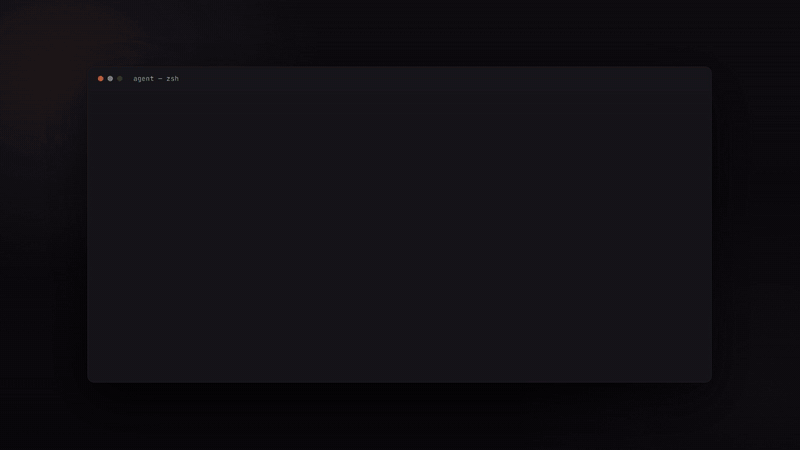

# agentarcade

[](https://github.com/SirjanSingh/agentarcade/actions/workflows/ci.yml)
[](LICENSE)
[](https://github.com/SirjanSingh/agentarcade/releases/latest)

Your coding agent is thinking. Play snake until it's done.

agentarcade is a tray app that opens a small game once your agent has been
working for a while, then closes itself the moment it finishes. You never press
a key to get back to work. The `Stop` hook hides the game and puts focus back in
your editor.

**[Download the latest release](https://github.com/SirjanSingh/agentarcade/releases/latest)**
for Windows (`.exe`) or macOS (`.dmg`).

<p align="center">
  
</p>

<p align="center">
  <em>Want the longer version? There's a
  <a href="docs/tour.mp4">60-second tour</a> with all eight games, the settings
  and sound.</em>
</p>

---

## The delay is the whole point

Most prompts get answered in about three seconds, and a game that opens on every
one of those is unusable. So agentarcade waits until your agent has been
thinking continuously for **10 seconds** before it interrupts you. Anything
shorter and no window ever opens.

Set it to 5, 10, 30 or 60 seconds from the tray menu.

---

## What it does to your machine

Worth knowing up front, since this is a tray app that offers to edit your
editor's config file.

**No network.** There is no HTTP client in the binary. No accounts, no
telemetry, no backend. Nothing leaves your machine, because there's nothing in
there that could send it.

The one opt-in exception is **Short videos** mode (Settings, Options). If you
turn it on, TikTok, Instagram Reels or YouTube Shorts load from the internet.
That happens either in their own windows or in your browser, and the sites see
you the way they would in any browser. Those windows get no access to the app.
Games mode, the default, never goes online.

**One local server**, bound to `127.0.0.1:47913`. That's how your editor's hooks
reach it. It rejects any request whose `Host` header isn't that exact loopback
address, which closes off the DNS rebinding path a web page could otherwise use
to reach a server on your own machine. It also rejects anything carrying the
`Origin` or `Sec-Fetch-*` headers a browser adds, so a page you visit can't
post to it directly either. Hooks come from curl or the agent itself, which
never send them.

**It writes to `~/.claude/settings.json`, but only when you ask it to.**
Clicking "Enable agent hooks" copies your file to
`settings.json.agentarcade-backup` first, then merges in three entries. The
write goes through a temp file and an atomic rename, so a crash halfway through
can't leave you with a truncated config. If your settings file isn't valid JSON,
agentarcade refuses to touch it and says so instead of replacing it. Turning
hooks off removes exactly the three entries it added and leaves everything else
alone, including your own hooks on the same events.

**Stats are one local JSON file**, at
`%APPDATA%\com.sirjan.agentarcade\stats.json` on Windows or
`~/Library/Application Support/` on macOS, next to `prefs.json`. The `deviceId`
in there is a random number. It isn't derived from your machine, your username,
or anything about you, and it never leaves the file.

---

## Games you make yourself

Type `/agentarcade:make dodge falling semicolons` in your agent's terminal and
that game joins the rotation about ten seconds later. Install the command from
the Games tab in settings — it writes a skill into `~/.claude/skills/`, and
refuses if a folder of that name is already there that it did not write.

**agentarcade does not generate anything.** It has no model and no network. The
game is written by the coding agent you are already running, into a folder the
app reads:

```
<app data>/games/semicolon-dodge/
  game.html    one self-contained file
  meta.json    id, label, score unit
```

**A generated game cannot reach the rest of the app.** It runs in an iframe
sandboxed with `allow-scripts` and without `allow-same-origin`, so it has an
opaque origin, and it is served over its own URI scheme with `default-src
'none'`. Measured from inside that frame: `localStorage` throws, the parent
document is unreachable, and `fetch` fails. Tauri injects its IPC object into
every frame, so the object is visible in there — but a command call from that
frame is refused and does not run, because no capability grants a remote
origin. The only thing that crosses the boundary is a score, over
`postMessage`.

A pack with a malformed `meta.json`, a name outside `a-z0-9-`, or a `game.html`
over 256 KB is skipped at startup and never enters the rotation. One bad pack
never stops the others loading.

**There is no way to install someone else's game.** Packs are not importable
and there is no gallery — a shareable file of executable JavaScript is a
distribution channel for malware. Games are shared by opening a pull request,
where a person reads them first.

Delete a game, or switch it off, from the Games and Options tabs.

---

## Install on Windows

Needs Windows 10 or 11 and the
[WebView2 runtime](https://developer.microsoft.com/en-us/microsoft-edge/webview2/),
which is already on most machines.

1. Download `agentarcade_*_x64-setup.exe` from
   [Releases](https://github.com/SirjanSingh/agentarcade/releases/latest)
2. Run it. The installer isn't code-signed yet, so Windows SmartScreen may say
   "Windows protected your PC". Click **More info**, then **Run anyway**.
3. A setup window opens on first launch and walks you through the two things
   that need doing.
4. After that it lives in the system tray, in the hidden icon area.

Closed the setup window by accident? It's under tray, **Settings & status**.

## Install on macOS

Needs macOS 11 or later, Apple Silicon or Intel.

1. Download the `.dmg` from
   [Releases](https://github.com/SirjanSingh/agentarcade/releases/latest).
   `*_aarch64.dmg` for M-series, `*_x64.dmg` for Intel.
2. Drag **agentarcade** into **Applications** and launch it. It lives in the
   menu bar with no Dock icon.

These builds aren't Apple-notarized. If macOS tells you the app is damaged or
from an unidentified developer, either right-click and choose **Open** the first
time, or run:

```bash
xattr -cr /Applications/agentarcade.app
```

---

## Setup

Two things, both in the setup window and in the tray menu.

**1. Start at login.** Hooks do nothing while the app isn't running, and that's
the one way agentarcade quietly does nothing at all.

**2. Connect your agents.** The **Setup** tab lists Claude Code, Codex, Cursor
and Antigravity, with a **Connect** button for each one found on this computer.
The tray's **Enable agent hooks** connects all of them at once.

| Agent | What Connect writes | Starts on | Ends on |
|---|---|---|---|
| Claude Code | `~/.claude/settings.json`, an `http` hook | `UserPromptSubmit`, `PreCompact` | `Stop` |
| Codex | `~/.codex/hooks.json`, a command hook | `UserPromptSubmit` | `Stop` |
| Cursor | `~/.cursor/hooks.json`, a command hook | `beforeSubmitPrompt`, `preCompact` | `stop` |
| Antigravity | `~/.gemini/config/hooks.json`, a command hook named `agentarcade` | first `PreInvocation` of a turn | `Stop` |

Codex, Cursor and Antigravity can only run commands, so their hook is a
`curl.exe` that forwards the hook's own JSON to the app. `curl.exe` ships with
Windows 10 (1803) and later, so there is nothing else to install. Every file is
backed up once before the first change, and **Disconnect** removes exactly what
Connect added.

Codex asks you to approve a new hook once before it runs: type `/hooks` in
Codex and trust the agentarcade entries.

If you used the old Node bridge for Cursor (`claudegame.js` or
`agentarcade.js` in `~/.cursor/hooks`), Connect replaces those entries. The
script file itself can be deleted.

### Check it worked

Tray, then **Play a game now**. Or tray, **Settings & status**, **Status**,
which tells you whether the hook endpoint is listening, whether hooks are
installed, and when the last hook arrived.

---

## The games

All eight ship to everyone. There's no paid tier and no gated content.

| | |
|---|---|
| **snake** | the classic, on a small grid |
| **typing** | words per minute against the clock |
| **aim** | click targets before they expire |
| **reaction** | how fast can you hit the flash |
| **gradient** | match the colour |
| **metronome** | keep the beat |
| **untangle** | pull the graph apart |
| **boulder** | endless runner, dodging syntax |

Switch between them mid-game with `Tab` and `Shift+Tab`. Turn any of them off in
**Settings**, **Options**.

---

## How it works

```
Editor hook --HTTP POST--> 127.0.0.1:47913/event   (inside the tray app)
                                   |
                                Tracker
         . per-session elapsed-time delay   . session ref-count
         . stale-session sweep              . no-repeat picker
                                   |
                        show / freeze / hide  -->  game window
```

| Hook event | What happens |
|---|---|
| Prompt submitted | start this session's clock |
| PreCompact | same |
| *(delay elapses, still thinking)* | show a random game |
| Stop | freeze, score card, hide, return focus |

The decision to show a game lives in a 500ms tick loop, not in the hook handler.
That is what makes a session which stops before the delay elapses open nothing
at all.

---

## Updates

Tray, then **Check for updates**. If there's a newer release it downloads,
verifies and installs it, then restarts.

It only checks when you click. There's no background update poll, because a
tray app that quietly phones home would contradict the rest of this page. The
download is checked against a signing key compiled into the binary, so a
release that isn't signed with the matching private key is refused.

---

## Configuration

`AGENTARCADE_PORT` overrides port 47913. Set it before launch. If hooks were
already installed on the old port, the Status view offers to clean up the
entries left behind.

Everything else is in the tray menu and under **Settings**, **Options**, and
persists to `prefs.json`.

---

## Development

```bash
npm install
npm run dev            # browser mode plus a dev bar, no Rust toolchain needed
npm run build          # typecheck and bundle
npm run test:rust      # unit tests
npm run check:game-ids # the TS and Rust game lists must agree
npm run tauri:dev      # the real app, with the dev-server CSP
npm run tauri build    # installer, into src-tauri/target/release/bundle/
```

`tauri:dev` applies `src-tauri/tauri.dev.conf.json`, which widens the CSP to
reach the Vite dev server. The base `tauri.conf.json` used by `tauri build` and
by CI releases has no localhost in its CSP.

Browser driver: `agentarcade.show("snake")` then `agentarcade.stop()`.

`tests/*.py` are manual Playwright smoke scripts. See
[tests/README.md](tests/README.md).

To cut a release, push a `v*` tag or run the **Release** workflow by hand.
GitHub Actions builds the Windows and macOS installers, so you don't need a Mac.

---

## Adding a game

Three touch points, and CI fails if the last two disagree:

1. `src/games/<id>.ts` implementing `GameModule` (see [`src/game.ts`](src/game.ts))
2. One line in `REGISTRY` in [`src/registry.ts`](src/registry.ts)
3. One id in `GAME_IDS` in [`src-tauri/src/logic/games.rs`](src-tauri/src/logic/games.rs)

More detail in [CONTRIBUTING.md](CONTRIBUTING.md).

---

## Contributing

Contributions are welcome, and new games are the easiest way in: most need no
Rust at all. Start with an issue labelled
[`good first issue`](https://github.com/SirjanSingh/agentarcade/labels/good%20first%20issue)
or [`new game`](https://github.com/SirjanSingh/agentarcade/labels/new%20game),
and read [CONTRIBUTING.md](CONTRIBUTING.md) before opening a PR. Agent support
beyond the four above is wanted too, as long as it's built on documented hook
events.

Please follow the [code of conduct](CODE_OF_CONDUCT.md), and report security
problems privately as described in [SECURITY.md](SECURITY.md).

---

## Platform status

| | Status |
|---|---|
| **Windows** | Primary, and the one I test on. NSIS installer on Releases. Focus returns to the previous window on hide. |
| **macOS** | CI builds an unsigned `.dmg` on every release tag. Focus return relies on the Accessory activation policy and has never been checked on real hardware. Reports welcome. |
| **Linux** | The code is there and builds an AppImage, but it isn't shipped on Releases and is community-tested only. |

---

## License

MIT. See [LICENSE](LICENSE).
