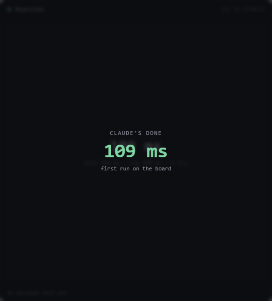
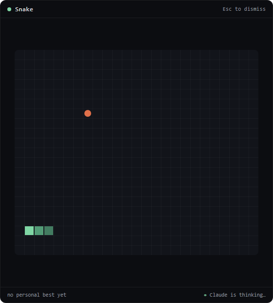
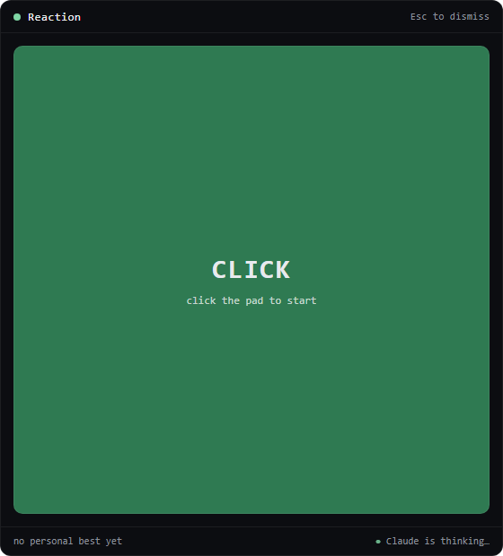
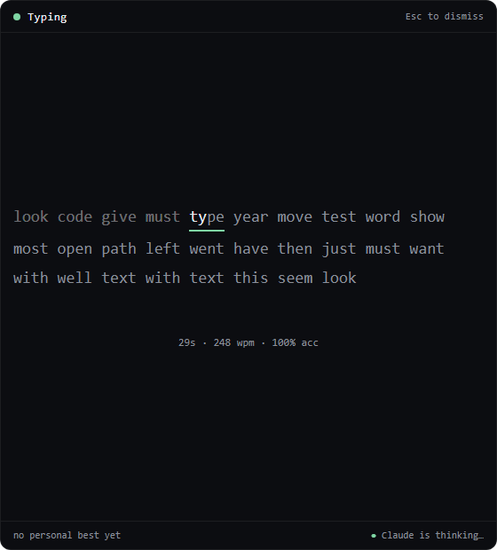
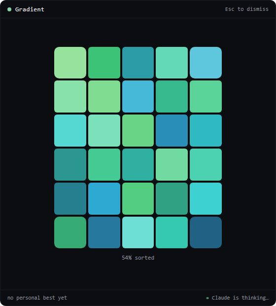
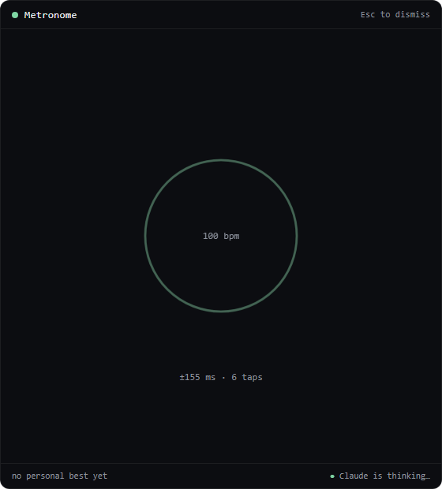
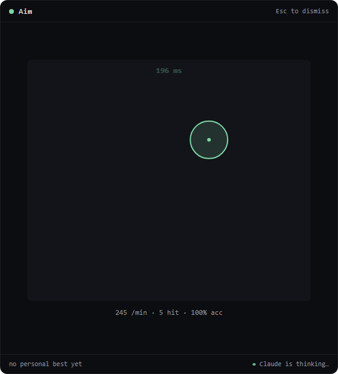
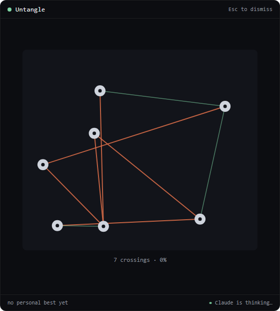
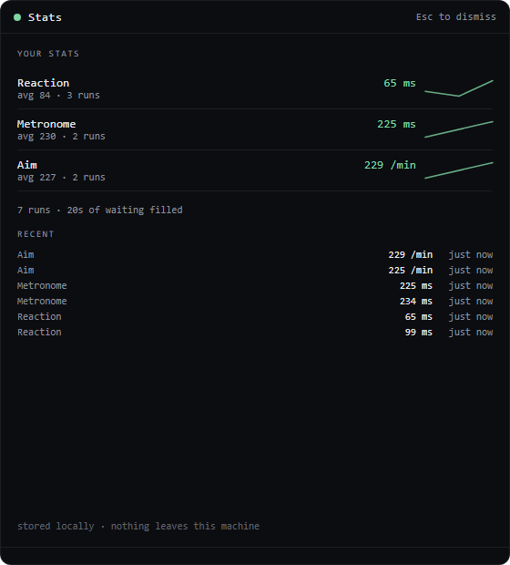

# claudegame

A tray app that pops up a quick mini-game whenever Claude Code starts thinking —
and dismisses itself the moment Claude is done.

Inspired by [microtaskrr](https://github.com/whoisyurii/microtaskrr), with two
differences: it is cross-platform (Windows first), and you never have to press
Esc to get back to work. The `Stop` hook closes the game for you.

<p align="center">
  
</p>
<p align="center"><em>Claude finishes, you get your score, the window leaves. No keypress.</em></p>

Eight games, a random one each time, never the same twice in a row:

| Game | You | Scored on |
|---|---|---|
| **Snake** | steer with arrows/WASD | apples per minute |
| **Reaction** | wait for green, click | best reaction, ms |
| **Typing** | type the words | words per minute |
| **Gradient** | swap tiles to restore a colour field | % sorted |
| **Metronome** | tap space on the beat | mean timing error, ms |
| **Aim** | click the targets | targets per minute |
| **Untangle** | drag nodes until no lines cross | % of crossings removed |
| **Boulder** | jump over code blocks, outrun the sunburst | metres per minute |

<table>
  <tr>
    <td align="center" width="33%"><br><sub><b>Snake</b> — apples per minute</sub></td>
    <td align="center" width="33%"><br><sub><b>Reaction</b> — wait for green</sub></td>
    <td align="center" width="33%"><br><sub><b>Typing</b> — words per minute</sub></td>
  </tr>
  <tr>
    <td align="center"><br><sub><b>Gradient</b> — restore the colour field</sub></td>
    <td align="center"><br><sub><b>Metronome</b> — tap on the beat</sub></td>
    <td align="center"><br><sub><b>Aim</b> — targets per minute</sub></td>
  </tr>
  <tr>
    <td align="center"><br><sub><b>Untangle</b> — pull the knot apart</sub></td>
    <td align="center"><br><sub><b>Stats</b> — bests and trends, all local</sub></td>
    <td></td>
  </tr>
</table>

Two rules every game follows, because runs are interrupted at an arbitrary
moment and scored on the spot:

- **The score is defined at every instant.** No "solved in N moves" games —
  frozen three seconds in, that number does not exist.
- **The score does not drift with run length.** Rates, percentages and
  best-single-event times, never running totals. Otherwise a personal best is
  just a record of the longest wait you have ever had.

---

## How it works

```
Claude Code ──HTTP POST──▶ 127.0.0.1:47913/event  (axum, inside the tray app)
                                   │
                            SessionTracker
                            · 2s debounce  · session ref-count  · no-repeat picker
                                   │
                          show / freeze / hide  ──▶  game window
```

Claude Code supports `http` hooks natively, so there is no shell script, no
bundled CLI, and nothing to put on `PATH`. The hook posts its own JSON payload
(`session_id`, `hook_event_name`) straight to the app.

| Hook event | What happens |
|---|---|
| `UserPromptSubmit` | show a random game |
| `PreCompact` | show a random game (compaction is a long wait) |
| `Stop` | freeze the run, show the score for 1.5s, hide, return focus |

Three details that matter in practice:

- **2-second debounce.** Claude Code's terminal-flicker bug can fire
  `UserPromptSubmit` several times in a row; only the first opens a game.
- **Session ref-counting.** With two Claude Code windows open, one finishing
  does not close the game the other is still keeping open.
- **Stale sweep.** A terminal killed without a `Stop` releases the window after
  10 minutes instead of pinning it open forever.

## Install

Requirements: Node 18+, Rust 1.82+, and the platform's Tauri v2 prerequisites
(on Windows: MSVC build tools + WebView2 runtime).

```bash
npm install
npm run tauri dev      # development
npm run tauri build    # installer in src-tauri/target/release/bundle
```

Then, from the tray menu, choose **Enable Claude Code hooks**. That merges three
entries into `~/.claude/settings.json`, keeping a one-time copy of your original
at `~/.claude/settings.json.claudegame-backup`. **Disable Claude Code hooks**
removes exactly what it added and leaves everything else untouched.

To wire it up by hand instead:

```jsonc
{
  "hooks": {
    "UserPromptSubmit": [{ "hooks": [{ "type": "http", "url": "http://127.0.0.1:47913/event", "timeout": 2 }] }],
    "PreCompact":       [{ "hooks": [{ "type": "http", "url": "http://127.0.0.1:47913/event", "timeout": 2 }] }],
    "Stop":             [{ "hooks": [{ "type": "http", "url": "http://127.0.0.1:47913/event", "timeout": 2 }] }]
  }
}
```

## Tray menu

- **Play a game now** — ignores both the pause state and the debounce.
- **Show stats** — bests, trends and totals.
- **Pause** — 15 minutes, 1 hour, or until you resume. `Stop` still hides an
  open game while paused.
- **Enable / Disable Claude Code hooks**
- **Start at login** — worth turning on: hooks that fire while the app isn't
  running do nothing at all.
- **Open stats file**

## Stats

**Show stats** in the tray menu opens a screen with per-game bests, a trend
sparkline of recent runs, and how much waiting you have filled. Esc closes it.

Local JSON, no accounts and no backend. Written atomically (temp file + rename)
so a crash mid-write cannot truncate it; an unreadable file is preserved as
`stats.json.bak` rather than overwritten.

The file is schema v2, shaped so a sync layer could be added later without a
rewrite: every run carries a stable id and timestamp, and the install has a
random `deviceId` that is not derived from anything about you or the machine. A
v1 file upgrades in place and keeps its bests. Nothing is uploaded anywhere —
there is no server to upload to.

| Platform | Location |
|---|---|
| Windows | `%APPDATA%\com.sirjan.claudegame\stats.json` |
| macOS | `~/Library/Application Support/com.sirjan.claudegame/stats.json` |
| Linux | `~/.config/com.sirjan.claudegame/stats.json` |

## Configuration

`CLAUDEGAME_PORT` overrides the default port (47913) if something else has it.
Set it before launching the app, and use the same port in the hook URLs — the
tray installer writes whichever port the running app is using.

The server binds `127.0.0.1` only. It is never reachable from the network.

## Adding a game

1. Write `src/games/<name>.ts` implementing `GameModule` from `src/game.ts`
   (`mount` / `freeze` / `destroy`, and call `api.reportScore`).
2. Add it to `REGISTRY` in `src/registry.ts`.
3. Add the same id to `GAMES` in `src-tauri/src/main.rs`.

## Development

```bash
npm run dev            # games in a plain browser, no Rust needed
npm run build          # typecheck + production bundle
npm run test:rust      # tracker, picker, hooks and stats unit tests
python tests/verify_games.py       # browser checks, against npm run dev
python tests/verify_new_games.py
python tests/verify_stats.py
python tests/capture_screenshots.py  # regenerate docs/screenshots
```

The Python suites need `playwright` (`pip install playwright && playwright
install chromium`) and a dev server already running. They drive the real page
and fire the same events the hooks do, which is how the frontend gets proven
independently of the Rust half.

Outside Tauri the page grows a control bar along the bottom — a game dropdown
plus Show / Claude done / Hide / Stats — which fires exactly the events the
hooks do. Stats live in `localStorage` there instead of `stats.json`.

The same driver is on `window.claudegame` for scripting:

```js
claudegame.show("snake");   // what UserPromptSubmit does
claudegame.stop();          // what Stop does
```

Drive the running app directly over its own endpoint:

```powershell
$u = "http://127.0.0.1:47913/event"
irm $u -Method Post -ContentType application/json -Body '{"session_id":"a","hook_event_name":"UserPromptSubmit"}'
irm $u -Method Post -ContentType application/json -Body '{"session_id":"a","hook_event_name":"Stop"}'
```

## Platform status

| | Status |
|---|---|
| Windows | Primary target. Focus returns to the terminal on hide via `GetForegroundWindow`/`SetForegroundWindow`. |
| macOS | Code is in place (`Accessory` activation policy, no Dock icon), not yet built or run on real hardware. |
| Linux | Code is in place; focus restore is left to the window manager, which may or may not oblige. |
